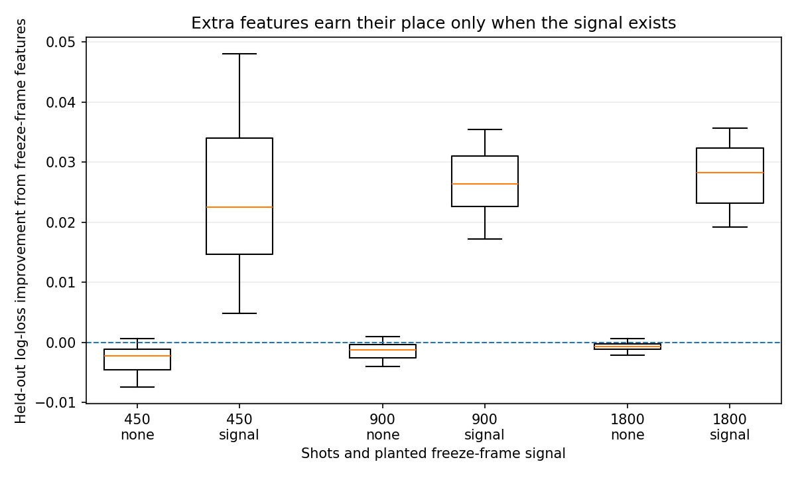
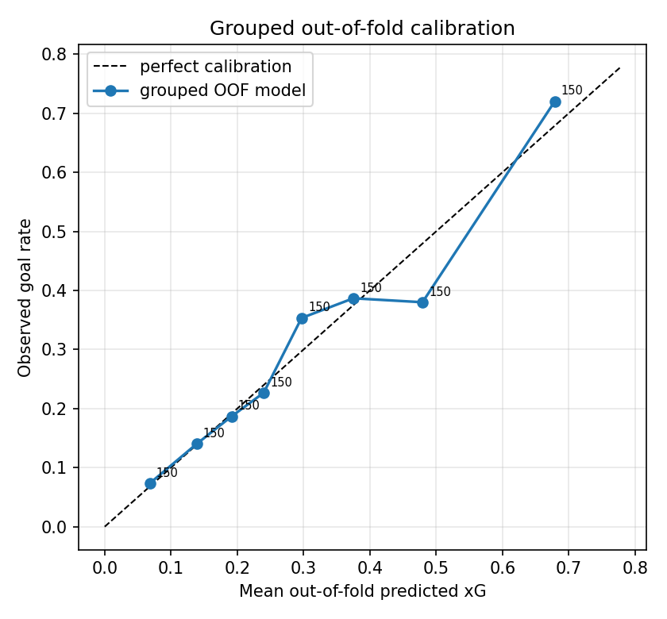

# Football Analytics: xG, xA, xT and Model Evaluation

[](https://github.com/AhmadEblagh205/football-xg-analytics/actions/workflows/ci.yml)


A football-analytics laboratory built around expected goals, post-shot modelling, expected threat and player-level uncertainty. The original project used StatsBomb's open Arsenal 2003/04 Premier League sample; the v0.8 audit separates **descriptive real-data outputs** from **model-validation evidence** and adds controlled synthetic worlds where the data-generating truth is known.

The central lesson is the same one that appears repeatedly in my research work: **an extra model term should earn its place out of sample**. A richer xG model can fit better simply because it has more features. The audited workflow therefore holds entire matches out when producing headline probabilities and uses negative controls to check that extra features do not manufacture apparent value when their signal is absent.

## What changed in the audit

The earlier release reported AUC, log loss, calibration and the geometry-vs-freeze-frame comparison on the same shots used to fit the model. Those numbers are preserved under `reports/legacy_real_data/` as historical descriptive outputs, but they are **not** v0.8 validation metrics.

The audited pipeline now uses five-fold stratified **group cross-fitting by match ID**. Every headline probability for a shot comes from a model that did not train on that match. The same out-of-fold probabilities feed calibration, xA and player evaluation. Match reports go one step further and fit on every other match before scoring the selected fixture.

Two additional implementation issues were fixed:

- the downloader previously fetched event files but not the lineup files required for per-90 minutes;
- the old `set_piece` flag treated almost every non-regular play pattern as a set piece, including goal kicks and keeper restarts. It is now restricted to explicit corner/free-kick/throw-in patterns.

The public repository is also fully offline-testable. The old test suite depended on absent raw StatsBomb files, so a clean clone failed three tests. The audited suite uses synthetic/temporary fixtures and currently has **18 passing tests** without downloading external data.

## Known-truth robustness experiment

`src/robustness.py` creates synthetic shot worlds with the same geometry/freeze-frame schema and varies whether blocker count and goalkeeper distance genuinely affect the goal probability.

At a sample size close to the old 918-shot Arsenal sample, across 20 independent worlds:

| 900 shots | Median ΔAUC from freeze features | Median Δlog loss | Freeze model wins on log loss |
|---|---:|---:|---:|
| No planted freeze-frame signal | **-0.0018** | **+0.00122** | **10%** |
| Planted freeze-frame signal | **+0.0340** | **-0.02634** | **100%** |

Negative Δlog loss is better. In the no-signal world, the two extra variables slightly hurt on average. When the signal is truly present, they improve held-out discrimination and probability quality consistently.



The result is deliberately a **methodological** claim, not a claim that these exact synthetic effect sizes describe Premier League football.

## xG model

The geometry model uses four transparent features for each non-penalty shot:

- distance to the centre of goal;
- angle subtended by the two posts;
- header indicator;
- explicit set-piece indicator.

The richer model adds two freeze-frame features when available:

- opposition defenders inside the shot cone;
- goalkeeper distance from the goal centre.

`src/model.py` fits full-data coefficients only for interpretation/visualisation; all reported model-quality metrics use grouped out-of-fold probabilities. It reports ROC AUC, log loss, Brier score and equal-frequency expected calibration error rather than treating ranking alone as sufficient.



If StatsBomb xG is available, the code also reports correlation with it. That is an **agreement diagnostic with another model**, not ground-truth validation.

## xA

Expected assists credit an assisted shot's **cross-fitted xG** to the passer. This keeps the downstream total from being built out of probabilities that were fitted on their own match.

## Post-shot placement

`src/placement.py` compares pre-strike geometry with goalmouth-placement features using the same grouped out-of-fold protocol. The checked-in synthetic run is a negative control: goalmouth coordinates are random, so a placement model should not create a material held-out improvement.

The earlier real-data finding that placement looked nearly flat while goalkeeper distance appeared more useful is preserved in `reports/legacy_real_data/`, but it was an in-sample result and is **not** treated as audited evidence until the current workflow is rerun on downloaded data.

## Player finishing and learning priority

The old scouting table used an ad-hoc goals/xG shrinkage ratio and then attached a variance expression that was not a coherent posterior variance. v0.8 replaces that with a regularised player-specific finishing offset:

\[
\operatorname{logit} P(\text{goal}_i)
=
\operatorname{logit}(xG_i)+\alpha_j,
\qquad
\alpha_j\sim N(0,\sigma_\alpha^2).
\]

For each player, a MAP estimate of \(\alpha_j\) is combined with a Laplace approximation to its uncertainty. The `learning_priority` score then asks how much a typical future match's worth of shots would be expected to reduce that finishing-offset variance.

That score is an **information diagnostic**, not a transfer recommendation, player valuation or claim that a club should literally scout the highest-ranked player.

## Expected threat (xT)

The xT model discretises the pitch into a 16 x 12 grid. Each zone's value is the probability that possession there eventually produces a goal:

\[
V = r + QV.
\]

Failed passes remain in the attempted-move denominator, so possession losses leak probability out of the transition system rather than being silently renormalised away.

v0.8 now solves the model two ways:

1. value iteration to a numerical tolerance;
2. the independent linear system \((I-Q)V=r\).

The test suite requires the two solutions to agree on a controlled toy pitch. This is a stronger numerical check than merely asserting that the surface rises toward goal on one downloaded season.

## Match reports

With real data downloaded:

```bash
python src/match_report.py --list
python src/match_report.py --match <match_id>
```

The selected match is excluded from fitting before its shots are scored. The report then creates a cumulative xG race, shot map and side-by-side xG/goal summary.

## Data

The real-data mode uses StatsBomb open data, competition `2`, season `44`: the **38 Arsenal Premier League matches from 2003/04** available in that open-data sample. It is not the complete 380-match Premier League season.

StatsBomb data are downloaded on demand and are not redistributed by this repository. Review StatsBomb's current open-data terms and attribution requirements before use:

`https://github.com/statsbomb/open-data`

The downloader now fetches and validates both events and lineups:

```bash
python src/download_data.py              # all available Arsenal league matches
python src/download_data.py --matches 12 # chronological subset
```

## Reproducing the audited offline evidence

```bash
pip install -r requirements.txt
pytest -q
python src/model.py --synthetic
python src/scouting.py --synthetic
python src/placement.py --synthetic
python src/robustness.py --worlds 20
```

Current checked-in v0.8 evidence comes from controlled synthetic runs because raw StatsBomb files are intentionally excluded from version control. After downloading the open data, rerun `model.py`, `scouting.py`, `placement.py` and `xt.py` to regenerate the real-data outputs under the audited methodology.

## What not to claim

This repository does **not** establish that:

- a freeze-frame model achieves 0.842 genuinely out of sample;
- StatsBomb xG is ground truth;
- the player learning-priority score is a professional recruitment model;
- the old placement result generalises beyond the analysed sample;
- xT is a causal measure of player quality;
- the 38-match dataset is the whole Premier League season.

The older 0.842 AUC, 0.83 xG-correlation, Henry xT/90 and placement outputs remain available only as legacy descriptive results until the real data are rerun through v0.8.

## Repository map

- `src/shots.py` — event parsing, geometry, freeze-frame features, known-truth generator
- `src/model.py` — grouped out-of-fold xG/xA/xGOT evaluation
- `src/robustness.py` — repeated known-truth feature-value experiment
- `src/scouting.py` — regularised finishing offsets and information priority
- `src/placement.py` — grouped out-of-fold post-shot placement comparison
- `src/xt.py` — leaky xT transition model and exact linear-system check
- `src/minutes.py` — lineup position-span minutes
- `src/match_report.py` — leave-one-match-out fixture report
- `reports/legacy_real_data/` — v0.7 real-data outputs retained for provenance, not headline validation

## Licence

MIT for the code. StatsBomb event/lineup data remain subject to StatsBomb's own terms and attribution requirements.
